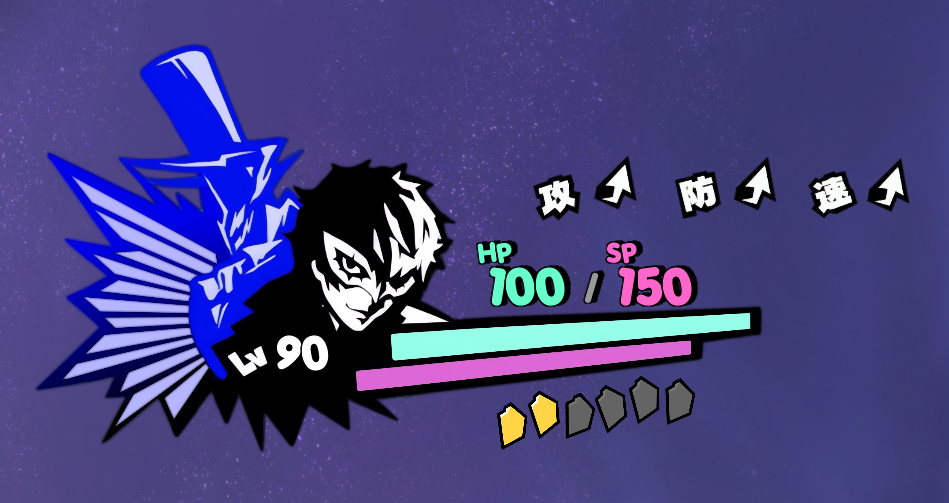
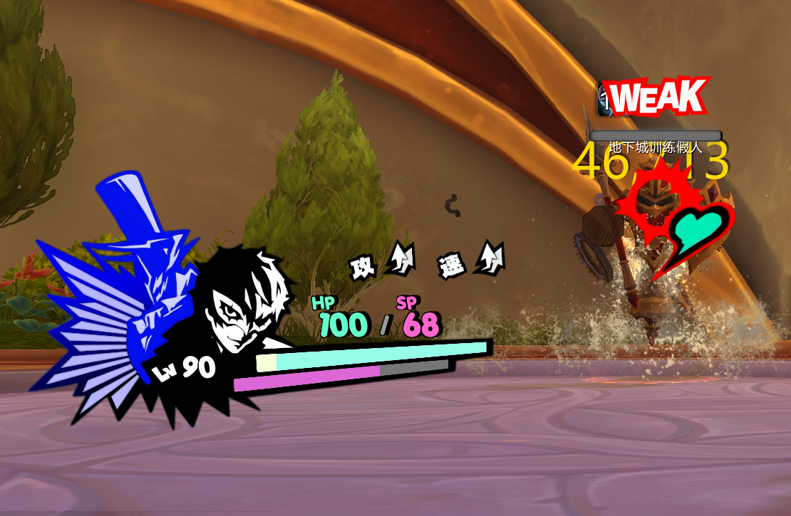
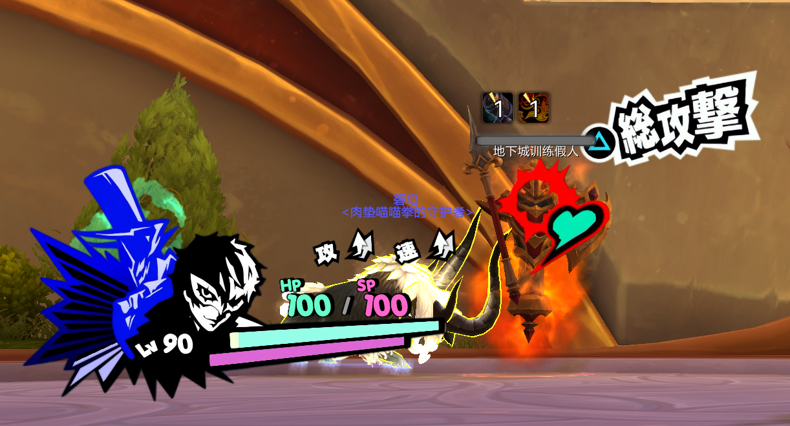
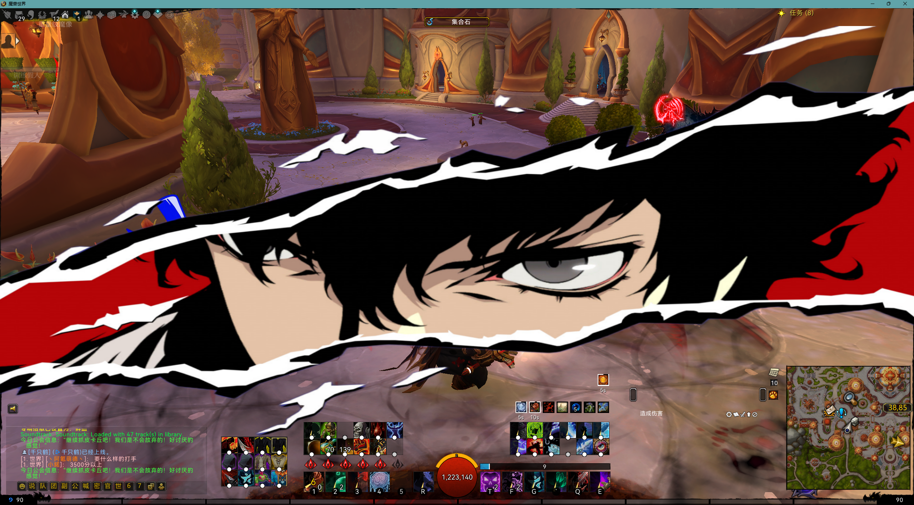
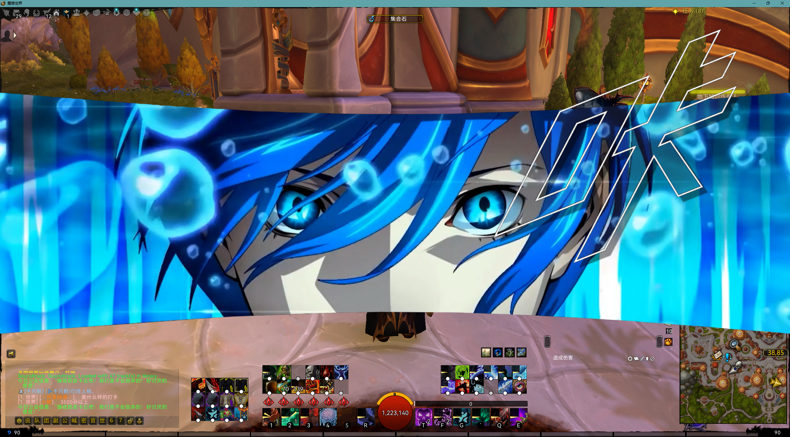
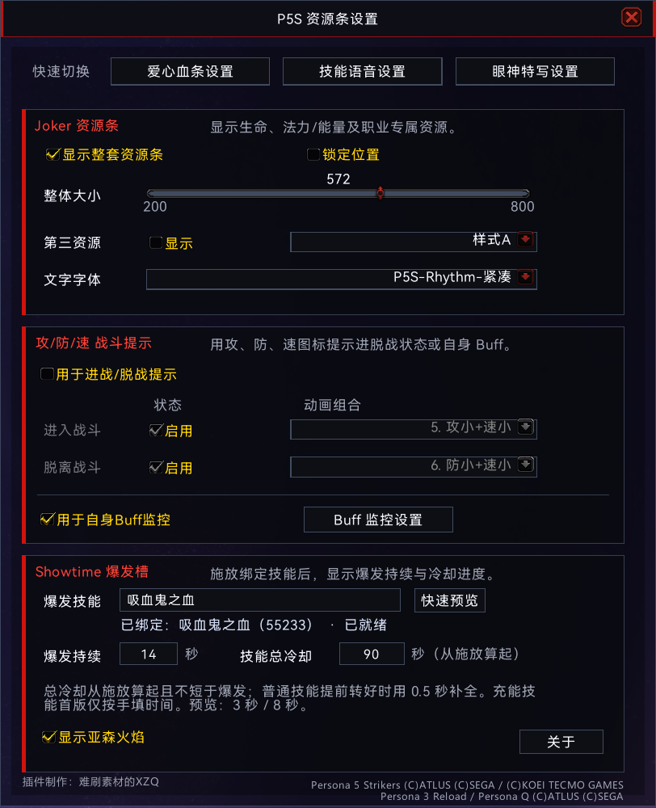

# P5S — Persona-Inspired UI for World of Warcraft

**《女神异闻录》风格的《魔兽世界》正式服界面插件。**  
*A Persona-inspired UI addon for World of Warcraft Retail.*

**版本 / Version:** 1.0.0
**作者 / Creator:** 难刷素材的XZQ (VolibearXZQ)  
**游戏版本 / Game:** World of Warcraft Retail（当前 `.toc` 接口号 / current `.toc` interface: `120100`）

[中文介绍](#中文介绍) · [English](#english)

---

## 中文介绍

### 关于 P5S

P5S 是一款为《魔兽世界》正式服制作的粉丝创作 UI 插件，灵感主要来自《女神异闻录5 乱战：魅影攻手》（Persona 5 Strikers），并融入了《女神异闻录》系列的其他视觉与语音元素。

我希望让魔兽世界的战斗界面更有《女神异闻录》的风格，同时保留根据自己所玩职业与技能进行配置的自由度。

### 主要功能

- **玩家主界面（P5S_UI）**：Joker 风格的生命值、护盾和职业资源显示；可配置的第三资源指示、攻防速提示，以及 Showtime 技能表现。
- **目标姓名板（P5_Nameplate）**：脱战时的目标装饰、进战后的爱心血条，以及 WEAK、CRITICAL、TECHNICAL、总攻击等战斗弹字与动画。
- **Weak 眼神特写**：可将指定技能与 Persona 风格的角色特写动画关联。
- **技能语音（P5_Voice）**：可为技能释放、冷却完成、治疗、爆发、战斗胜利及角色事件设置语音；提供 Joker（雨宫莲）和结城理的语音素材选择，以及可保存的语音方案。
- **个性化设置**：通过游戏内设置面板调整部分组件的显示、位置、大小与触发条件；配置按角色保存。

不同职业、游戏版本和战斗环境下的具体表现可能有所不同。部分功能受《魔兽世界》正式服插件 API 限制。

### 游戏截图

**主界面**

**战斗特效**

**设置面板**

### 安装方法

1. 从本仓库的 [Releases](https://github.com/VolibearXZQ/WOW-P5S-UI/releases) 页面下载发布版 ZIP 压缩包，解压后得到 `P5S` 文件夹。
2. 将 `P5S` 文件夹放入《魔兽世界》正式服的 `World of Warcraft/_retail_/Interface/AddOns/` 目录。
3. 确认文件结构为 `Interface/AddOns/P5S/P5S.toc`，然后启动或重载游戏，并在插件列表中启用 **P5S**。

> 如果使用 GitHub 的 **Code → Download ZIP** 下载源码，请将解压后的仓库根文件夹重命名为 `P5S`；不要额外嵌套一层目录。

### 游戏内命令

| 命令 | 功能 |
| --- | --- |
| `/p5s` | 打开或关闭主界面设置 |
| `/p5target` | 打开或关闭目标血条设置 |
| `/p5voice` | 打开或关闭技能语音设置 |
| `/p5weak` | 打开或关闭 Weak 眼神特写设置 |
| `/p5atk` | 在当前目标上预览总攻击弹字 |

主界面设置中也提供前往其他设置页面的入口。

### 开发与特别鸣谢

**创作者：难刷素材的XZQ（VolibearXZQ）**

本项目的构思、视觉设计方向、功能规划、配置设计、素材整理及游戏内测试由我负责。除引用的第三方作品素材外，插件的自定义功能与 Lua 实现由我借助 AI 编程工具持续设计、制作与完善。

特别感谢 **OpenAI ChatGPT** 和 **OpenAI Codex** 在技术讨论、Lua 开发、问题排查及功能迭代中提供的帮助。没有这些工具的协助，这个项目很难以目前的形式完成。

### 版权与非官方声明

P5S 是**非官方粉丝项目**，并非 ATLUS、SEGA、Blizzard Entertainment 或其他相关权利人的官方产品，也未获得其赞助或背书。

本项目涉及的《女神异闻录》系列及《魔兽世界》的名称、角色、图像、音频和其他原作素材，其相应权利归各自的权利人所有。所涉及的作品包括但不限于 *Persona 5 Strikers*、*Persona 3 Reload* 和 *Persona Q*。

本项目中对原作素材的引用不代表作者拥有该等素材的版权，也不意味着相关素材获得了可自由转载、修改或商业使用的许可。如有权利人提出合理的版权要求，我会进行核实并采取适当处理。

目前本仓库**未附带统一的开源许可证**。公开提供源码并不意味着仓库内代码、图像、音频等内容可任意复制、再分发或商用；尤其是第三方素材，其使用权应遵循原权利人的规定。

### 反馈

如发现问题或有功能建议，欢迎通过本仓库的 [Issues](https://github.com/VolibearXZQ/WOW-P5S-UI/issues) 页面留言。反馈时尽量说明游戏版本、职业/专精、重现步骤及报错信息。

---

## English

### About P5S

P5S is a fan-made UI addon for **World of Warcraft Retail**, primarily inspired by *Persona 5 Strikers*, with additional visual and voice elements inspired by the wider *Persona* series.

The goal is to bring some of Persona's distinctive style into WoW combat while allowing players to customize the interface for their own classes and abilities.

### Features

- **Player UI (P5S_UI):** Joker-inspired health, absorb shields, and class resource display, with additional resource indicators, attack/defense/speed visuals, and a configurable Showtime ability display.
- **Target Nameplate (P5_Nameplate):** Out-of-combat target decorations, an in-combat heart-shaped health bar, and animated WEAK, CRITICAL, TECHNICAL, and All-Out Attack text effects.
- **Weak Portrait Effects:** Persona-style character portrait animations that can be assigned to selected abilities.
- **Skill Voices (P5_Voice):** Configurable audio for spell casts, cooldown completion, healing, burst abilities, victories, and character events, with Joker (Ren Amamiya) and Makoto Yuki voice selections and savable voice presets.
- **Customization:** In-game controls for supported positions, sizes, visibility, and triggers, with per-character settings.

Behavior may vary across classes and game versions. Some features are subject to WoW Retail addon API restrictions.

### Screenshots

**Main Frame**

**Combat**

**Settings**

### Installation

1. Download a release ZIP from [Releases](https://github.com/VolibearXZQ/WOW-P5S-UI/releases) and extract the `P5S` folder.
2. Place it inside `World of Warcraft/_retail_/Interface/AddOns/`.
3. Make sure the file is located at `Interface/AddOns/P5S/P5S.toc`. Launch or reload the game and enable **P5S** in the addon list.

> If you download the source through **Code → Download ZIP**, rename the extracted repository root folder to `P5S` and avoid creating an extra nested folder.

### Slash Commands

| Command | Description |
| --- | --- |
| `/p5s` | Toggle the main settings panel |
| `/p5target` | Toggle target nameplate settings |
| `/p5voice` | Toggle skill voice settings |
| `/p5weak` | Toggle Weak portrait effect settings |
| `/p5atk` | Preview the All-Out Attack effect on your current target |

The main settings panel also links to the other configuration pages.

### Development & Acknowledgements

**Created by 难刷素材的XZQ (VolibearXZQ).**

I am responsible for the project's concept, visual direction, feature planning, configuration design, asset organization, and in-game testing. Apart from third-party source material, the addon's custom functionality and Lua implementation were developed and refined with AI-assisted programming tools.

Special thanks to **OpenAI ChatGPT** and **OpenAI Codex** for helping with technical discussions, Lua development, debugging, and feature iteration. Their assistance has been invaluable in making this project possible.

### Copyright & Disclaimer

P5S is an **unofficial fan-made project**. It is not affiliated with, sponsored by, or endorsed by ATLUS, SEGA, Blizzard Entertainment, or any other relevant rights holder.

Names, characters, images, audio, and other original material from the *Persona* series and *World of Warcraft* remain the property of their respective rights holders. Referenced works include, but are not limited to, *Persona 5 Strikers*, *Persona 3 Reload*, and *Persona Q*.

The inclusion of any original material does not imply ownership of that material or permission for unrestricted reuse, modification, redistribution, or commercial use. If a rights holder raises a legitimate concern, I will review it and take appropriate action.

**No general open-source license is currently provided for this repository.** Public source availability should not be interpreted as blanket permission to reuse or redistribute its code, images, or audio. Third-party assets remain subject to their respective owners' rights.

### Feedback

For bugs and suggestions, please open an [Issue](https://github.com/VolibearXZQ/WOW-P5S-UI/issues). When possible, include your game version, class/spec, steps to reproduce, and any error messages.
